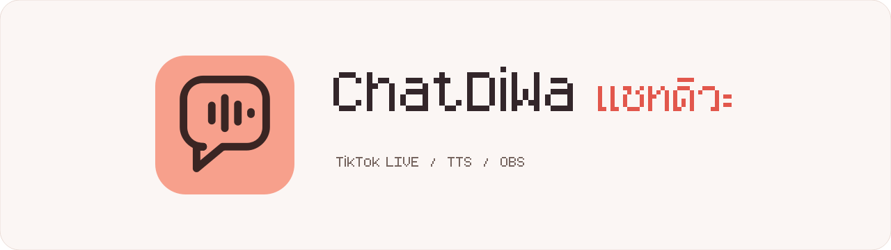

<p align="center">
  <picture>
    <source media="(prefers-color-scheme: dark)" srcset="assets/banner-dark.png">
    
  </picture>
</p>

ChatDiWa reads your TikTok LIVE chat aloud. The speech goes into your stream through a Browser Source
in OBS or TikTok LIVE Studio, so you do not need a virtual audio cable or any other audio software.
It runs on your own computer.

[Download](#download) · [Adding the sound to OBS](#adding-the-sound-to-obs) · [TikTok LIVE Studio](#tiktok-live-studio) · [The control panel](#the-control-panel) · [Troubleshooting](#troubleshooting) · [Uninstalling](#uninstalling) · [ภาษาไทย](#แชทดิวะ-ภาษาไทย)

## Download

1. Open the [latest release](https://github.com/Babyferret/chatdiwa/releases/latest) and download `ChatDiWa.zip`.
2. Extract it (right-click, then **Extract All**). You get a `ChatDiWa` folder that you can put anywhere, for example on the Desktop.
3. Open the folder and double-click `run.bat`. If Node.js is not installed, it asks before installing it. It never installs anything silently.
4. Your browser opens the control panel. Type your TikTok username and press **Connect**.

Every time you start `run.bat` it fetches the latest version from GitHub, so there is nothing to update by hand. Your settings stay in the same `ChatDiWa` folder.

**What you need**

- Windows 10 or 11, with an internet connection.
- OBS Studio or TikTok LIVE Studio.
- Node.js 18 or newer. `run.bat` offers to install it.

When it starts, the program prints two links:

```
Open http://localhost:3939
- Open this link in a normal browser to see the chat, change settings and connect to TikTok
- Add http://localhost:3939/?obs=1 as a Browser Source in OBS to put the sound into your stream
```

## Adding the sound to OBS

You do this once.

1. In OBS, press `+` in the **Sources** box and choose **Browser**.
2. Name it (for example "ChatDiWa") and press OK.
3. Set the URL to `http://localhost:3939/?obs=1` and press OK.

New comments are now read into your stream. This one Browser Source carries both the sound and the optional overlay:

| You want | Do this |
| --- | --- |
| Sound only | Hide the source with the eye icon. The sound keeps playing while it is hidden. |
| Sound and overlay | Turn on **Show overlay** in the settings and show the source. The name and message appear at the bottom left and fade after 8 seconds. Only comments that were actually read aloud appear. |
| Overlay only | Mute the source in OBS's own audio mixer. The sliders inside ChatDiWa change the voice, they do not mute it. |

Use the link with `?obs=1` for OBS only. Opened in a normal browser it makes no sound, because browsers block autoplay and OBS does not. That is expected, not a bug.

## TikTok LIVE Studio

TikTok LIVE Studio calls a Browser Source a **Link** source, and it does not accept `localhost` links. ChatDiWa can create a temporary public link for it:

1. Open the **Settings** tab and find **TikTok LIVE Studio**.
2. Tick **Enable a public link for TikTok LIVE Studio**. The first time, it downloads the tunnel helper (a few seconds).
3. When the status says it is ready, press **Copy**.
4. In TikTok LIVE Studio choose **+ Add source**, then **Link**, paste the link and save.

The link changes each time the program restarts or the option is switched off and on, so update the Link source whenever that happens. If you leave the program running, the same link keeps working.

## The control panel

Open `http://localhost:3939`. This page never plays sound, so it cannot double up with OBS. It has two tabs:

- **Chat** shows every comment that arrives. Comments that were not read aloud are dimmer.
- **Settings** has:
  - **TikTok connection**: type a username and press **Connect** to join or switch rooms without restarting. **Disconnect** leaves the room. The dot in the top right shows the state: green is connected, yellow is connecting, red is an error.
  - **Voice**: male or female, with rate, pitch and volume sliders (-50% to +50%).
  - **Message format**: "name says message", or the message alone.
  - **Read mode**: read everything, or read only comments that start with a prefix you choose (for example `.` or `/`). Other comments still show in the chat, they are just not spoken.
  - **Overlay**, **TikTok LIVE Studio**: see the sections above.
  - **Filters**: maximum message length, maximum queue size, blocked usernames and words that are never read.

**Save** applies the changes at once. **Reset all settings** returns everything to the defaults and disconnects from TikTok.

After you have entered a username once, ChatDiWa reconnects to it by itself on the next start. Press `Ctrl+C` in the terminal, or close the `run.bat` window, to quit.

## Troubleshooting

- You must be **live right now** when you press Connect. ChatDiWa only joins a live room.
- Check the username. Copy it from your TikTok profile URL, without the `@`.
- If the connection drops during a stream, ChatDiWa reconnects by itself. If you pressed **Disconnect** yourself, it stays disconnected until you press **Connect**.

## Uninstalling

ChatDiWa is not installed as a Windows program. `run.bat` downloads it fresh on every start. Everything it keeps is in the folder that holds `run.bat`:

| File | What it is |
| --- | --- |
| `chatdiwa.config.json` | All your settings. |
| `.chatdiwa-audio-cache\` | Temporary audio. It deletes itself after playing, so it is normally empty. |
| `.chatdiwa-bin\cloudflared.exe` | About 55 MB. Downloaded only if you enable the public link for TikTok LIVE Studio. |
| `.chatdiwa-app\` | The program itself, downloaded from GitHub. |

To remove it, delete the whole `ChatDiWa` folder. Nothing runs in the background and nothing is stored elsewhere. If `run.bat` installed Node.js for you and you use it for nothing else, remove it in Windows Settings, then Apps, or with `winget uninstall OpenJS.NodeJS.LTS`.

## Fonts

The banner is drawn with TA GBA monothai by Taweechai Assawarangsitsang (TA Font), licensed under the SIL Open Font License 1.1.

## License

ChatDiWa is released under the MIT License.

---

## แชทดิวะ (ภาษาไทย)

อ่านแชท TikTok LIVE ออกเสียงให้อัตโนมัติ เสียงเข้าสตรีมผ่าน Browser Source ของ OBS หรือ TikTok LIVE Studio
ไม่ต้องติดตั้ง virtual audio cable หรือโปรแกรมเสียงเพิ่ม และทำงานบนเครื่องของคุณเองทั้งหมด

### ดาวน์โหลดและเริ่มใช้งาน

1. เปิด[หน้า release ล่าสุด](https://github.com/Babyferret/chatdiwa/releases/latest) แล้วโหลด `ChatDiWa.zip`
2. แตกไฟล์ (คลิกขวา → Extract All) จะได้โฟลเดอร์ `ChatDiWa` วางไว้ที่ใดก็ได้
3. ดับเบิลคลิก `run.bat` ถ้ายังไม่มี Node.js สคริปต์จะถามก่อนว่าจะติดตั้งให้ไหม
4. เบราว์เซอร์จะเปิดหน้าควบคุม กรอก username TikTok แล้วกด **Connect**

ทุกครั้งที่เปิด `run.bat` จะได้เวอร์ชันล่าสุดจาก GitHub เอง การตั้งค่าเก็บอยู่ในโฟลเดอร์ `ChatDiWa` เดียวกัน

### เพิ่มเสียงเข้า OBS

ใน OBS กด `+` ที่ช่อง **Sources** เลือก **Browser** แล้วใส่ URL `http://localhost:3939/?obs=1` ทำครั้งเดียว

- เสียงอย่างเดียว: ซ่อน Source ด้วยไอคอนรูปตา เสียงยังออกตามปกติ
- เสียงและ Overlay: เปิด "แสดง overlay" ในหน้าตั้งค่า ชื่อและข้อความจะขึ้นมุมล่างซ้ายและจางหายใน 8 วินาที เฉพาะคอมเมนต์ที่ถูกอ่านจริง
- Overlay อย่างเดียว: ปิดเสียงของ Source นี้ที่ audio mixer ของ OBS

ใช้ลิงก์ที่มี `?obs=1` กับ OBS เท่านั้น ถ้าเปิดในเบราว์เซอร์ปกติจะไม่มีเสียง ซึ่งเป็นเรื่องปกติ

### ใช้กับ TikTok LIVE Studio

TikTok LIVE Studio ไม่รับลิงก์ `localhost` ให้ไปที่ **ตั้งค่า** → **TikTok LIVE Studio** แล้วติ๊ก "เปิดใช้ลิงก์สาธารณะสำหรับ TikTok LIVE Studio" รอสถานะ "พร้อมใช้งาน" กด **คัดลอก** แล้วนำไปวางที่ **+ Add source** → **Link** ลิงก์จะเปลี่ยนทุกครั้งที่เปิดโปรแกรมใหม่ ต้องแก้ใน TikTok LIVE Studio ให้ตรงทุกครั้ง

### หน้าควบคุม

เปิดที่ `http://localhost:3939` หน้านี้ไม่เล่นเสียง มี 2 แท็บ คือ **แชท** (ดูคอมเมนต์ทั้งหมด อันที่ไม่ถูกอ่านจะจางกว่า) และ **ตั้งค่า** (การเชื่อมต่อ TikTok, เสียงชาย/หญิง, rate, pitch, volume, รูปแบบข้อความ, Read Mode, Overlay, ตัวกรอง) กด **บันทึก** มีผลทันที กด **รีเซ็ตการตั้งค่าทั้งหมด** เพื่อกลับเป็นค่าเริ่มต้นและตัดการเชื่อมต่อ TikTok

### ถ้าเชื่อมต่อไม่ติด

ต้องกำลังไลฟ์อยู่จริงตอนกด Connect และใส่ username ให้ถูก (ไม่ต้องมี `@`) ถ้าหลุดเองโปรแกรมจะเชื่อมใหม่ให้ แต่ถ้ากด Disconnect เอง จะไม่เชื่อมใหม่จนกว่าจะกด Connect

### การถอนการติดตั้ง

ลบโฟลเดอร์ `ChatDiWa` ทั้งโฟลเดอร์ ไม่มีอะไรทำงานเบื้องหลังหรือเก็บข้อมูลที่อื่น ถ้าต้องการถอน Node.js ด้วย ให้ไปที่ Windows Settings → Apps หรือใช้ `winget uninstall OpenJS.NodeJS.LTS`
